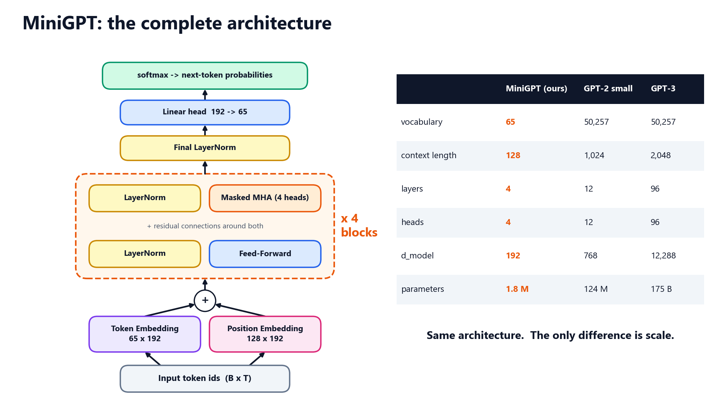
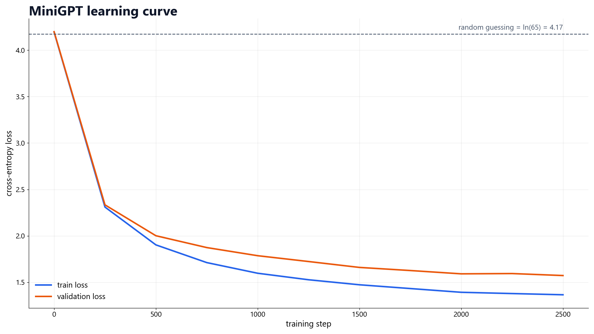
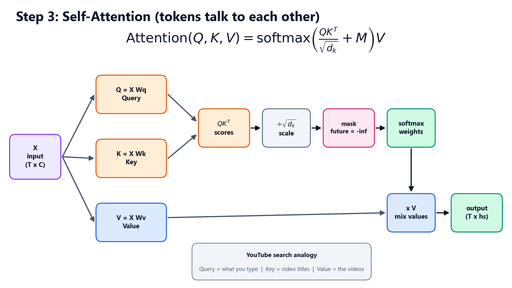

# MiniGPT From Scratch

A GPT-style transformer language model, written from scratch in PyTorch, trained on a laptop CPU in about
30 minutes, and served in a small web app. Companion code for the course
**Build Your Own ChatGPT: LLM & Transformers From Scratch**.



**From scratch** means PyTorch is used only for tensors, autograd and `nn.Module`. Linear, Embedding,
LayerNorm, GELU, Dropout, softmax, cross-entropy, attention, the transformer block, the GPT model, the AdamW
optimiser and both tokenizers (character-level and Byte-Pair Encoding) are written by hand.

## Quick start

```bash
git clone <your-repo-url> MiniGPT-From-Scratch
cd MiniGPT-From-Scratch
python -m venv .venv
.venv\Scripts\activate            # Mac/Linux: source .venv/bin/activate
pip install -r requirements.txt

python tests/test_minigpt.py      # 12 correctness tests
python generate.py --prompt "ROMEO:"   # uses the trained checkpoint included in checkpoints/
python app.py                     # web playground at http://127.0.0.1:7860
```

Train it yourself (downloads Tiny Shakespeare on first run):

```bash
python train.py                   # about 30 minutes on a laptop CPU
python train.py --max-iters 300   # quick demo
python train.py --data my_text.txt --out-dir checkpoints/my_model   # your own text
```

## Prefer one file?

`minigpt_complete.py` contains the entire project in a single, readable, runnable file:

```bash
python minigpt_complete.py test
python minigpt_complete.py train --max-iters 300
python minigpt_complete.py generate --prompt "JULIET:"
```

## Results

| | |
|---|---|
| parameters | 1,829,376 |
| layers / heads / embedding size | 4 / 4 / 192 |
| context length | 128 characters |
| training | 2,500 steps, 29 minutes on a laptop CPU |
| validation loss | 4.20 at start, 1.57 after training |



Sample, written by the trained model:

```
ROMEO:
How to must in the
right of his brother's earness, if you no content;
And as the present of my lord,
In of your noble heavens commands you.

FRIAR LAURENCE:
Your grains my designess to full me of thrive,
```

## Project structure

```
minigpt/
  config.py       model + training settings
  layers.py       Linear, Embedding, LayerNorm, GELU, Dropout, softmax, cross-entropy
  attention.py    scaled dot-product, single-head and multi-head attention
  model.py        TransformerBlock and MiniGPT (+ generation and attention maps)
  tokenizer.py    character tokenizer and byte-level BPE
  data.py         dataset download, train/validation split, batches
  optim.py        AdamW, gradient clipping, cosine learning-rate schedule
train.py          training loop with evaluation, checkpoints, loss curve and samples
generate.py       command-line text generation (streams token by token)
app.py            Gradio playground: generate, next-token lab, attention viewer, architecture
minigpt_complete.py   everything above in one file
tests/            checks every hand-written layer against PyTorch's own implementation
notebooks/        step-by-step notebook: tokenization to attention to training
experiments/      ready-to-run experiments and ideas to try next
checkpoints/      trained model (minigpt.pt) and training log
diagrams/         architecture diagrams
```

## How it works



1. **Tokenize**: every character becomes an integer (65 in Tiny Shakespeare).
2. **Embed**: each token id selects a learned 192-number vector, plus a position vector.
3. **Attend**: causal self-attention lets every token gather information from earlier tokens only.
4. **Stack**: 4 transformer blocks of attention + feed-forward, with residual connections and layer norm.
5. **Predict**: a linear head gives a score for every possible next character; softmax turns them into probabilities.
6. **Generate**: sample a character, append it, repeat.

## Experiments

See [`experiments/`](experiments/README.md) for runnable experiments (top-p sampling, an anomaly
"surprise detector") and a list of ideas to try next.

## License

MIT, see [LICENSE](LICENSE). Tiny Shakespeare dataset from Andrej Karpathy's char-rnn.
